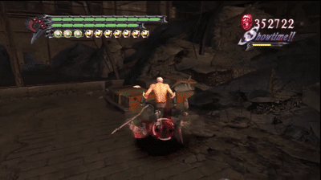

# PS2 Web Recomp

This is my browser port of **Devil May Cry 3**. The game's Emotion Engine code is translated ahead of time into C++ and compiled to WebAssembly, while a runtime emulates the rest of the PlayStation 2 and draws with WebGPU.

  
   
  <a href="docs/media/demoDMC3.mp4">Watch the full demo (2:52)</a>

The browser build boots through the title screen and menus, loads a save, visits the mission map and item shop, and plays combat at about 60 frames per second in Chrome with WebGPU. Sound, gamepad input and memory-card saves work in the browser.

This is the sibling of [psp-web-recomp](https://github.com/snuri00/psp-web-recomp) and follows the same method.

## How it works

**Recompilation.** `eerecomp` reads the game's executable, follows its control flow to find the functions and emits C++ for them in units of 16 KiB of guest code. The output keeps the R5900's quirks: 128-bit registers and the multimedia instructions that work on them, branch delay slots, the PS2's floating point unit, which has no infinities or denormals and rounds differently from IEEE, and vector unit 0 used as a coprocessor. Jumps between units become tail calls, and a thread switch unwinds the host stack and resumes at the guest address, so the generated code never needs a stack per guest thread.

**A small PS2 kernel.** The EE side of the operating system is answered by high-level emulation: threads, semaphores, interrupt handlers for the DMA controller and the vertical blank, alarms, and the SIF channel that connects the main CPU to the I/O processor. The I/O processor runs the game's own IRX modules, the sound driver, the disc streaming code and the controller and memory card drivers that ship on the disc, on an interpreter of its R3000 CPU, while the IOP kernel and the libraries those modules call are reimplemented in C++. Game data is read over HTTP Range requests, so only the executable is downloaded up front.

**Vector units.** Most of a PS2 game's 3D work happens in microprograms the game uploads to vector unit 1. They run with the pipeline delays of the MAC, status and clip flags modelled, because games schedule their code around them, and with the PS2's float rules for special values: no infinities or NaNs, denormals flushed to zero and overflow clamped to the largest float. The arithmetic itself is the host's, so a result can differ from the console's in its last bit; the console truncates where the host rounds, and its multiplier is not exact. Microprograms seen during a test run are compiled ahead of time into SIMD C++; any the page meets for the first time are translated into a WebAssembly module on the spot, which takes a few milliseconds per program.

**Graphics.** The Graphics Synthesizer's 4 MB of video memory lives on the GPU, in its native swizzled layouts, and drawing is done by WebGPU compute shaders: triangles are binned into tiles and rasterized with the GS's own rules for texturing, palettes, alpha blending, depth and destination alpha tests. Because everything stays in GS memory, effects that render into a texture or reinterpret a framebuffer as a palette work the way they do on the console. The internal resolution can be one, two or three times the native one. A software rasterizer of the same GS remains as the reference the GPU output is compared against.

**Threads.** The emulation runs in a worker, vector unit 1 has a worker of its own the way it runs in parallel on the console, and the GS commands go through a ring buffer to the page thread, which owns the WebGPU device.

**Sound and movies.** The SPU2 is reimplemented with its 48 voices of ADPCM, ADSR envelopes and the streaming DMA games use for music, and its output goes to an AudioWorklet through shared memory. Movies are decoded by an implementation of the IPU, the PS2's MPEG-2 decoder.

## Performance

Getting a full 3D game to run at speed in the browser took a few changes. The GS moved to WebGPU compute shaders and the vector unit programs are compiled ahead of time. Uploads are hoisted ahead of triangles that do not depend on them, a GPU-side cache serves repeated texture uploads, and per-triangle setup is loaded uniformly. The emulation yields through a `MessageChannel` instead of nested `setTimeout` calls and runs in a worker, so the page thread only feeds the GPU.

## Controls

The page needs WebGPU for the GPU renderer. Chrome and Edge have it on Windows and macOS. On Linux it is off by default in Chrome and Chromium: turn on `chrome://flags/#enable-unsafe-webgpu` and `chrome://flags/#enable-vulkan` and restart the browser, as the page tells you when it finds no usable adapter. Without WebGPU the software renderer takes over, which is fine for menus and far too slow for 3D. On laptops with two GPUs, a canvas drawn on the discrete GPU sometimes cannot be shown on the screen; the page tries both adapters and falls back to copying frames through a 2D canvas.

The keyboard maps the face buttons to Z (cross), X (circle), A (square) and S (triangle), the shoulders to Q, W, 1 and 2, start and select to Enter and Backspace, the D-pad to the arrow keys and the left stick to I, J, K and L. Gamepads work through the browser's gamepad API. Their analog triggers reach the game as the DualShock 2's pressure-sensitive L2 and R2, and controllers with motors vibrate when the game asks for it, in browsers that expose vibration (Chrome and Edge do). Phones get on-screen controls, and F toggles fullscreen. The resolution selector reloads the page at the new size, and so does the 4:3/16:9 selector, which tells the game the TV is widescreen the way the PS2's system settings do and shows the picture at that shape.

## Saves

The page puts a memory card in slot 1 and keeps it in the browser's storage for the address you play from, so progress survives a reload. Games format and use it as they would a real card. **Export card** downloads it as a `.ps2` file in the layout PCSX2 uses, and **Import card** puts such a file back in the slot, so a card can travel between browsers or come from PCSX2. `?nocard` starts with the slot empty.

## Legal

This repository contains only original code and third-party code under its own license. It does not include the game, its data, or a playable build. The generated C++ and WebAssembly are translations of the game's executable and remain the property of the game's owners. The gameplay clip is shown for demonstration only; all game assets belong to their owners. Devil May Cry, PlayStation and related marks are trademarks of their respective owners. This project is not affiliated with or endorsed by Capcom or Sony Interactive Entertainment.

## Credits

The VLC tables of the MPEG decoder are adapted from [Play!](https://github.com/jpd002/Play-) (BSD 2-clause, notice in `runtime/src/ipu/NOTICE`). PCSX2, Play! and the ps2sdk headers were the references for much of the hardware and system behavior emulated here. wgpu-native and Dawn provide WebGPU natively and in the browser, and Emscripten builds the WebAssembly.

## License

The code in this repository is available under the MIT License, see [LICENSE](LICENSE). `runtime/src/ipu/tables.hpp` keeps the BSD 2-clause notice of Play!.
